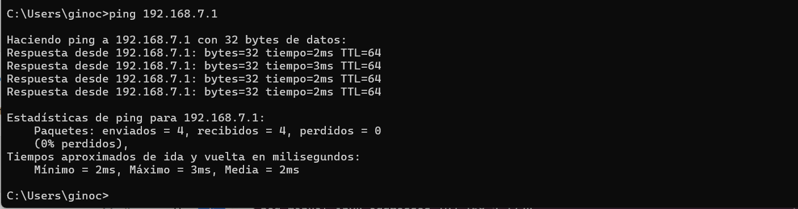
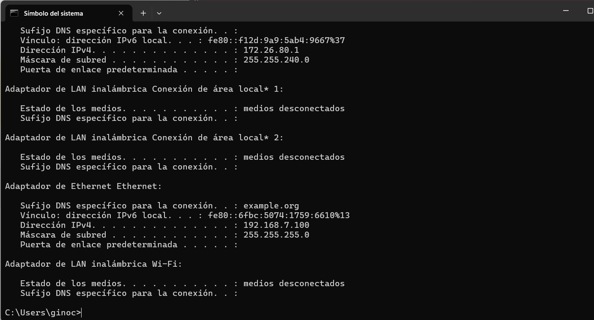
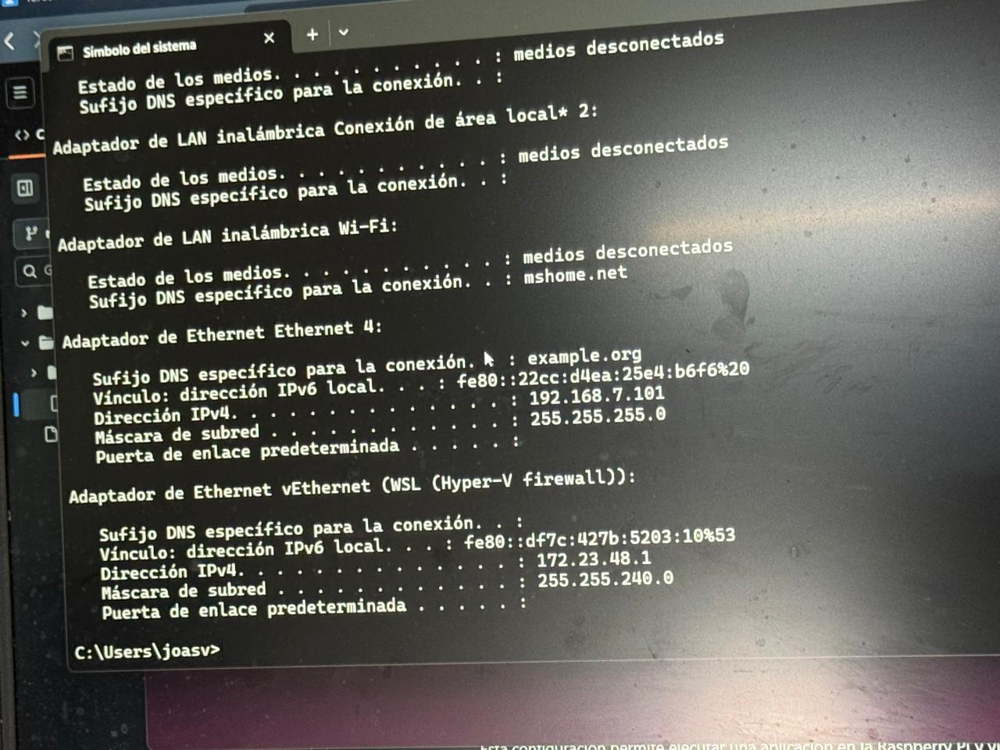
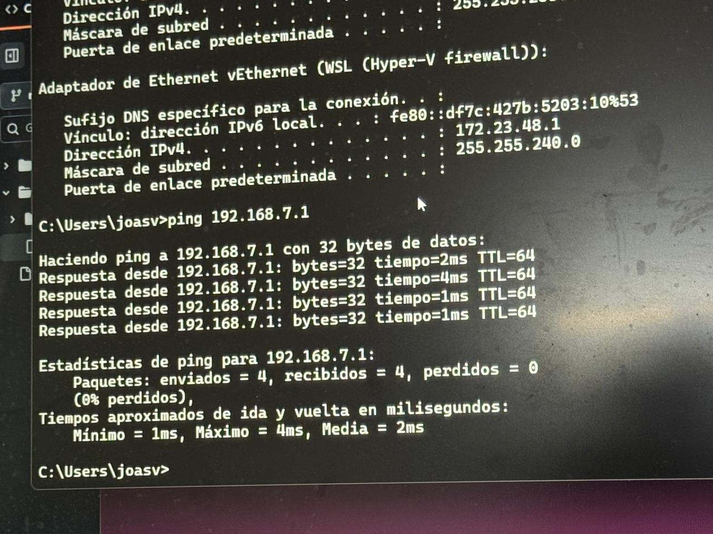
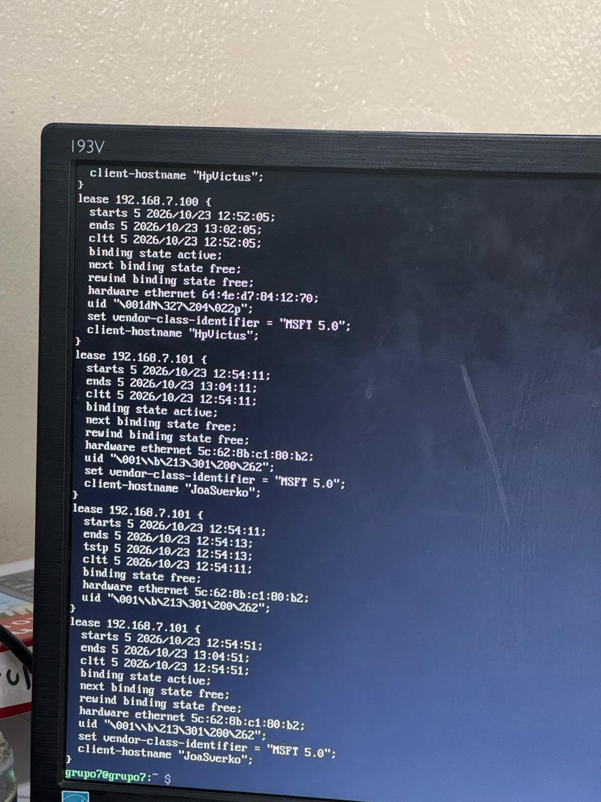
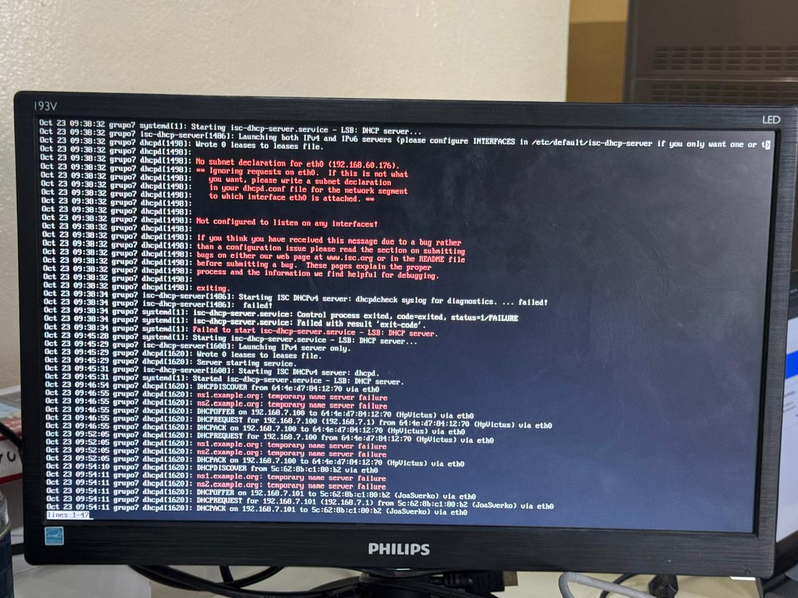

# TERCERA ENTREGA - SERVIDOR DHCP

**Alumnos:** Candiotto Gino, Joaquin Sverko, Genaro Correa, Facundo Angelelli

**Fecha:** 23 de octubre

**Tema:** Instalación y configuración de un servidor DHCP en Raspberry Pi

## 1. INTRODUCCIÓN

En las entregas anteriores se preparó una Raspberry Pi para utilizarla como servidor dentro de una red local.

Primero se instaló **Raspberry Pi OS Lite (64-bit)**, sin entorno gráfico de escritorio, y se configuró el servicio **SSH** para permitir la administración remota del dispositivo desde otra computadora.

Posteriormente se instalaron los componentes necesarios de **Xorg** y se configuró **X11 Forwarding** mediante SSH, permitiendo ejecutar aplicaciones gráficas en la Raspberry Pi y visualizar sus ventanas desde una computadora cliente.

En esta tercera entrega se continuó ampliando las funciones de la Raspberry Pi mediante la instalación y configuración de un **servidor DHCP**.

El objetivo es que la Raspberry Pi sea capaz de asignar automáticamente direcciones IP a las computadoras conectadas a la red LAN de nuestro grupo.

La red correspondiente al **grupo 7** es:

```text
192.168.7.0/24
```

La Raspberry Pi se conecta mediante Ethernet al switch de la mesa y actúa como servidor DHCP para las demás computadoras conectadas al mismo switch.

---

## 2. OBJETIVOS DE LA PRÁCTICA

Los objetivos principales de esta entrega fueron:

- Comprender qué es el protocolo DHCP.
- Comprender el funcionamiento del modelo cliente-servidor aplicado a DHCP.
- Configurar una dirección IP fija en la Raspberry Pi.
- Instalar un servidor DHCP en Raspberry Pi OS.
- Configurar el rango de direcciones IP que puede entregar el servidor.
- Utilizar la interfaz Ethernet de la Raspberry Pi para brindar el servicio.
- Conectar la Raspberry Pi y las notebooks mediante un switch.
- Configurar las computadoras clientes para obtener una dirección IP automáticamente.
- Comprobar la asignación de direcciones IP dentro de la red.
- Representar la topología implementada mediante Cisco Packet Tracer.

---

## 3. ¿QUÉ ES DHCP?

**DHCP** significa *Dynamic Host Configuration Protocol*.

Es un protocolo de red utilizado para asignar automáticamente parámetros de configuración de red a los dispositivos que se conectan a una red.

Sin DHCP, sería necesario configurar manualmente en cada computadora parámetros como:

- Dirección IP.
- Máscara de subred.
- Puerta de enlace.
- Servidores DNS.

Mediante DHCP, un servidor puede entregar automáticamente esta información a los dispositivos clientes.

Por ejemplo, si tenemos una red:

```text
192.168.7.0/24
```

un servidor DHCP podría asignar automáticamente direcciones como:

```text
192.168.7.100
192.168.7.101
192.168.7.102
192.168.7.103
```

Cada dispositivo recibe una dirección diferente para evitar conflictos dentro de la red.

---

## 4. CLIENTE Y SERVIDOR DHCP

En DHCP intervienen principalmente dos elementos:

- **Servidor DHCP:** dispositivo encargado de entregar configuraciones de red.
- **Cliente DHCP:** dispositivo que solicita automáticamente una configuración de red.

En nuestro caso:

```text
SERVIDOR DHCP → Raspberry Pi
CLIENTES DHCP → Notebooks conectadas al switch
```

La Raspberry Pi permanece encendida y conectada mediante Ethernet al switch.

Las notebooks también se conectan al mismo switch y están configuradas para obtener su dirección IP automáticamente.

---

## 5. FUNCIONAMIENTO BÁSICO DE DHCP

Cuando una computadora configurada como cliente DHCP se conecta a la red, necesita encontrar un servidor que pueda proporcionarle una dirección IP.

El proceso básico de DHCP puede resumirse mediante cuatro mensajes principales.

### 5.1. DHCP Discover

El cliente todavía no tiene una dirección IP y envía un mensaje buscando servidores DHCP disponibles.

```text
CLIENTE
   |
   | DHCP Discover
   v
RED LOCAL
```

### 5.2. DHCP Offer

El servidor DHCP recibe la solicitud y ofrece al cliente una dirección IP disponible.

Por ejemplo:

```text
192.168.7.100
```

### 5.3. DHCP Request

El cliente responde indicando que desea utilizar la dirección ofrecida por el servidor.

### 5.4. DHCP Acknowledgement

Finalmente, el servidor confirma la asignación de la dirección.

Este proceso suele representarse mediante las siglas:

```text
DORA
```

que corresponden a:

```text
Discover
Offer
Request
Acknowledgement
```

---

## 6. ¿QUÉ ES UNA CONCESIÓN DHCP?

Las direcciones IP asignadas por DHCP normalmente no son entregadas de manera permanente.

El servidor concede una dirección durante un período determinado denominado:

```text
Lease
```

o **concesión**.

Por ejemplo, una computadora podría recibir:

```text
IP: 192.168.7.100
```

durante un determinado período.

Cuando el tiempo de concesión se aproxima a su finalización, el cliente puede solicitar su renovación.

Esto permite reutilizar direcciones IP de dispositivos que ya no se encuentran conectados a la red.

---

## 7. RED UTILIZADA

La consigna establece que cada grupo debe utilizar una red LAN con el siguiente formato:

```text
192.168.NUMERO_DE_GRUPO.0
```

Nuestro grupo corresponde al número:

```text
7
```

Por lo tanto, la red utilizada es:

```text
192.168.7.0/24
```

El prefijo `/24` corresponde a la máscara:

```text
255.255.255.0
```

La configuración planificada fue:

```text
Dirección de red:        192.168.7.0
Máscara:                 255.255.255.0
Raspberry Pi:            192.168.7.1
Rango DHCP inicial:      192.168.7.100
Rango DHCP final:        192.168.7.200
Broadcast:               192.168.7.255
Interfaz utilizada:      eth0
```

La dirección `192.168.7.1` queda reservada para la Raspberry Pi y no forma parte del rango de direcciones entregadas automáticamente.

---

## 8. TOPOLOGÍA DE LA RED

La red LAN está formada mediante el switch correspondiente al grupo.

Tanto la Raspberry Pi como las computadoras clientes se conectan directamente al switch mediante Ethernet.

El esquema general es:

```text
                         RED 192.168.7.0/24

                              SWITCH
                         ┌──────┼──────┐
                         │      │      │
                         │      │      │
                         v      v      v

                    RASPBERRY   PC1    PC2
                       PI

                  192.168.7.1   DHCP   DHCP
                  SERVIDOR
                     DHCP
```

La Raspberry Pi es el dispositivo encargado de proporcionar las direcciones IP a las computadoras.

---

## 9. DIAGRAMA EN PACKET TRACER

Para representar el diseño de la red se realizó una topología en **Cisco Packet Tracer**.

La Raspberry Pi puede representarse mediante un servidor debido a que su función dentro de esta práctica es brindar un servicio de red.

La topología contiene:

- Un switch.
- Un servidor representando la Raspberry Pi.
- Las computadoras clientes.
- Conexiones Ethernet entre todos los dispositivos y el switch.

El esquema lógico utilizado es:

```text
                         ┌────────────────┐
                         │     SWITCH     │
                         │      2960      │
                         └───┬────┬────┬──┘
                             │    │    │
                 ┌───────────┘    │    └───────────┐
                 │                │                │
                 v                v                v
          ┌─────────────┐   ┌──────────┐    ┌──────────┐
          │ RASPBERRY   │   │   PC 1   │    │   PC 2   │
          │ PI / SERVER │   │          │    │          │
          └─────────────┘   └──────────┘    └──────────┘
                 │                │                │
          192.168.7.1           DHCP             DHCP
          DHCP SERVER
```

> **Imagen:** agregar captura de la topología realizada en Cisco Packet Tracer.

```markdown

```

---

## 10. ACCESO REMOTO A LA RASPBERRY PI

Para realizar la configuración del servidor se utilizó nuevamente SSH.

La sintaxis utilizada para conectarse es:

```bash
ssh grupo7@IP_DE_LA_RASPBERRY
```

Para poder utilizar este comando primero es necesario conocer la dirección IP que posee la Raspberry Pi en la red donde se encuentra conectada inicialmente.

Desde una computadora con Ubuntu puede intentarse resolver el nombre configurado para la Raspberry mediante:

```bash
ping servidor-rpi.local
```

Durante las pruebas, el nombre puede no resolverse correctamente mediante mDNS.

En ese caso se pueden consultar los dispositivos conocidos por la computadora utilizando:

```bash
ip neigh
```

También puede verificarse la propia configuración de red mediante:

```bash
ip addr
```

Una vez identificada la Raspberry Pi se puede realizar la conexión SSH mediante su dirección IP.

---

## 11. VERIFICACIÓN DE LAS INTERFACES DE RED

Una vez establecida la conexión SSH con la Raspberry Pi se verificaron las interfaces de red disponibles.

Para ello se puede utilizar:

```bash
ip -br addr
```

Este comando muestra de manera resumida las interfaces y sus direcciones IP.

Un resultado puede tener una estructura similar a:

```text
lo      UNKNOWN    127.0.0.1/8
eth0    UP         DIRECCION_IP/24
```

La interfaz de interés para esta práctica es:

```text
eth0
```

ya que corresponde a la conexión Ethernet utilizada para conectar la Raspberry Pi al switch.

---

## 12. ACTUALIZACIÓN DE LOS PAQUETES

Antes de instalar el servidor DHCP se actualizó la información de paquetes disponibles mediante:

```bash
sudo apt update
```

Este comando consulta los repositorios configurados en el sistema y descarga la información correspondiente a las versiones de paquetes disponibles.

No instala directamente las actualizaciones, sino que actualiza los índices utilizados por `apt`.

---

## 13. INSTALACIÓN DEL SERVIDOR DHCP

Para implementar el servicio se utilizó el paquete:

```text
isc-dhcp-server
```

La instalación se realiza mediante:

```bash
sudo apt install isc-dhcp-server -y
```

Los elementos principales del comando son:

- **`sudo`:** ejecuta el comando con privilegios administrativos.
- **`apt`:** gestor de paquetes utilizado por Debian y Raspberry Pi OS.
- **`install`:** indica que se desea instalar un paquete.
- **`isc-dhcp-server`:** paquete que proporciona el servidor DHCP.
- **`-y`:** responde automáticamente de manera afirmativa a las confirmaciones de instalación.

---

## 14. CONFIGURACIÓN DE LA INTERFAZ DEL SERVIDOR DHCP

Después de instalar el servicio se debe indicar sobre qué interfaz de red debe escuchar el servidor DHCP.

Para ello se edita:

```bash
sudo nano /etc/default/isc-dhcp-server
```

Dentro del archivo se encuentra la variable:

```text
INTERFACESv4=""
```

Como la Raspberry Pi se conecta al switch mediante Ethernet, se configura:

```text
INTERFACESv4="eth0"
```

Esto indica que el servicio DHCP debe atender solicitudes IPv4 recibidas mediante la interfaz Ethernet `eth0`.

---

## 15. CONFIGURACIÓN DEL SERVIDOR DHCP

La configuración principal del servidor se encuentra en:

```text
/etc/dhcp/dhcpd.conf
```

Para editar el archivo se utiliza:

```bash
sudo nano /etc/dhcp/dhcpd.conf
```

La configuración utilizada para nuestra red es:

```conf
default-lease-time 600;
max-lease-time 7200;

authoritative;

subnet 192.168.7.0 netmask 255.255.255.0 {
    range 192.168.7.100 192.168.7.200;
    option subnet-mask 255.255.255.0;
    option broadcast-address 192.168.7.255;
}
```

---

## 16. EXPLICACIÓN DE LA CONFIGURACIÓN DHCP

### `default-lease-time`

```conf
default-lease-time 600;
```

Establece el tiempo de concesión predeterminado en segundos.

En este caso:

```text
600 segundos = 10 minutos
```

### `max-lease-time`

```conf
max-lease-time 7200;
```

Establece el tiempo máximo durante el cual una concesión puede mantenerse.

```text
7200 segundos = 2 horas
```

### `authoritative`

```conf
authoritative;
```

Indica que este servidor es el servidor DHCP autorizado para la red configurada.

### `subnet`

```conf
subnet 192.168.7.0 netmask 255.255.255.0
```

Define la red sobre la cual trabajará el servidor.

### `range`

```conf
range 192.168.7.100 192.168.7.200;
```

Define el conjunto de direcciones que pueden ser entregadas automáticamente a los clientes.

En este caso el servidor puede asignar direcciones desde:

```text
192.168.7.100
```

hasta:

```text
192.168.7.200
```

### `option subnet-mask`

```conf
option subnet-mask 255.255.255.0;
```

Indica la máscara de subred que recibirán los clientes.

### `option broadcast-address`

```conf
option broadcast-address 192.168.7.255;
```

Indica la dirección de broadcast correspondiente a la red.

---

## 17. CONFIGURACIÓN DE UNA IP FIJA EN LA RASPBERRY PI

Para funcionar correctamente como servidor DHCP, la Raspberry Pi debe utilizar una dirección IP conocida y estable dentro de la red.

Se decidió utilizar:

```text
192.168.7.1/24
```

Primero puede consultarse la conexión Ethernet disponible mediante:

```bash
nmcli connection show
```

El resultado permite conocer el nombre asignado a la conexión.

Por ejemplo:

```text
NAME                TYPE      DEVICE
Wired connection 1  ethernet  eth0
```

Si la conexión se denomina:

```text
Wired connection 1
```

puede asignarse la dirección fija mediante:

```bash
sudo nmcli connection modify "Wired connection 1" ipv4.method manual ipv4.addresses 192.168.7.1/24
```

Luego se aplica la configuración mediante:

```bash
sudo nmcli connection up "Wired connection 1"
```

Después de modificar la dirección IP, una conexión SSH establecida utilizando la dirección anterior puede cerrarse debido al cambio de red.

A partir de ese momento la Raspberry Pi debe ser accesible mediante:

```text
192.168.7.1
```

---

## 18. CONEXIÓN FÍSICA DE LA RED

Una vez configurada la Raspberry Pi se conectaron los dispositivos al switch.

La distribución física es:

```text
Raspberry Pi eth0
        |
        | Ethernet
        v
     SWITCH
     /    \
    /      \
   v        v
 PC 1      PC 2
```

Todos los dispositivos deben pertenecer a la misma red física.

Las computadoras clientes deben configurarse para obtener automáticamente su dirección IP.

---

## 19. INICIO DEL SERVICIO DHCP

Una vez completada la configuración se reinicia el servicio DHCP mediante:

```bash
sudo systemctl restart isc-dhcp-server
```

Este comando detiene y vuelve a iniciar el servicio utilizando la nueva configuración.

Para hacer que el servidor DHCP se inicie automáticamente cuando se encienda la Raspberry Pi puede utilizarse:

```bash
sudo systemctl enable isc-dhcp-server
```

---

## 20. VERIFICACIÓN DEL ESTADO DEL SERVICIO

Para comprobar que el servidor DHCP esté funcionando se utiliza:

```bash
sudo systemctl status isc-dhcp-server
```

Si la configuración es correcta, el servicio debe aparecer como:

```text
Active: active (running)
```

Esto indica que el servidor DHCP está ejecutándose correctamente.


---

## 21. CONFIGURACIÓN DE LAS COMPUTADORAS CLIENTES

Las notebooks conectadas al switch deben configurarse para utilizar DHCP.

Esto significa que no se debe asignar manualmente una dirección IP.

El sistema debe estar configurado para:

```text
Obtener una dirección IP automáticamente
```

Cuando una computadora se conecta a la red, enviará una solicitud DHCP.

La Raspberry Pi deberá responder asignándole una dirección disponible dentro del rango:

```text
192.168.7.100 - 192.168.7.200
```

---

## 22. RENOVACIÓN DE DIRECCIÓN IP EN WINDOWS

En una computadora con Windows puede solicitarse una nueva dirección IP abriendo CMD o PowerShell.

Primero puede liberarse la dirección anterior mediante:

```powershell
ipconfig /release
```

Después se solicita una nueva dirección al servidor DHCP:

```powershell
ipconfig /renew
```

Finalmente se consulta la configuración recibida:

```powershell
ipconfig
```

El resultado esperado debe incluir una dirección perteneciente a la red:

```text
192.168.7.0/24
```

Por ejemplo:

```text
IPv4 Address:     192.168.7.100
Subnet Mask:      255.255.255.0
```

Otra computadora podría recibir:

```text
192.168.7.101
```

El número concreto dependerá de las direcciones disponibles y de las concesiones existentes.

---

## 23. COMPROBACIÓN DE CONECTIVIDAD

Una vez que una computadora recibe correctamente una dirección IP, se puede comprobar la comunicación con la Raspberry Pi mediante:

```bash
ping 192.168.7.1
```

Si la configuración es correcta, la Raspberry Pi debe responder.

Esto demuestra que ambos dispositivos:

- Se encuentran conectados físicamente.
- Pertenecen a la misma red.
- Poseen configuraciones IP compatibles.

---

## 24. CONEXIÓN SSH DENTRO DE LA NUEVA RED

Después de configurar la Raspberry Pi con la dirección:

```text
192.168.7.1
```

se puede volver a utilizar SSH.

Desde una computadora conectada a la LAN se ejecuta:

```bash
ssh grupo7@192.168.7.1
```

De esta manera es posible continuar administrando el servidor remotamente utilizando la dirección IP fija configurada para la Raspberry Pi.

---

## 25. CONSULTAR LAS CONCESIONES DHCP

El servidor guarda información relacionada con las direcciones IP asignadas.

Esta información puede consultarse mediante:

```bash
sudo cat /var/lib/dhcp/dhcpd.leases
```

En este archivo pueden aparecer registros similares a:

```text
lease 192.168.7.100 {
    ...
}
```

Cada bloque representa información relacionada con una concesión realizada por el servidor.

Esta comprobación permite verificar que el servidor DHCP efectivamente ha entregado direcciones IP a los clientes.

> **Imagen:** agregar captura donde se observen las concesiones realizadas.

```markdown

```

---

## 26. CONSULTAR LOS REGISTROS DEL SERVICIO

También puede consultarse la información generada por el servidor DHCP mediante:

```bash
sudo journalctl -u isc-dhcp-server
```

Este comando permite visualizar los registros asociados al servicio.

Los logs resultan especialmente útiles para diagnosticar errores y comprobar solicitudes realizadas por los clientes.



---

## 27. COMANDOS UTILIZADOS

A continuación se detallan los principales comandos utilizados durante la práctica.

### 1. Consultar las interfaces de red

```bash
ip -br addr
```

Muestra de manera resumida las interfaces de red y las direcciones IP configuradas.

---

### 2. Consultar dispositivos conocidos desde Ubuntu

```bash
ip neigh
```

Muestra información de dispositivos detectados en la red local.

---

### 3. Consultar la configuración completa de red

```bash
ip addr
```

Muestra las interfaces de red y sus respectivas direcciones.

---

### 4. Actualizar los índices de paquetes

```bash
sudo apt update
```

Actualiza la información de paquetes disponibles en los repositorios.

---

### 5. Instalar el servidor DHCP

```bash
sudo apt install isc-dhcp-server -y
```

Instala el software necesario para convertir la Raspberry Pi en servidor DHCP.

---

### 6. Configurar la interfaz utilizada por DHCP

```bash
sudo nano /etc/default/isc-dhcp-server
```

Permite definir que el servidor DHCP utilice la interfaz `eth0`.

---

### 7. Editar la configuración DHCP

```bash
sudo nano /etc/dhcp/dhcpd.conf
```

Permite configurar la red, el rango de direcciones y otros parámetros entregados a los clientes.

---

### 8. Consultar las conexiones de red

```bash
nmcli connection show
```

Muestra las conexiones configuradas mediante NetworkManager.

---

### 9. Configurar IP fija

```bash
sudo nmcli connection modify "Wired connection 1" ipv4.method manual ipv4.addresses 192.168.7.1/24
```

Configura la dirección IPv4 fija utilizada por la Raspberry Pi.

---

### 10. Aplicar la configuración de red

```bash
sudo nmcli connection up "Wired connection 1"
```

Activa nuevamente la conexión utilizando la configuración modificada.

---

### 11. Reiniciar el servidor DHCP

```bash
sudo systemctl restart isc-dhcp-server
```

Reinicia el servicio para aplicar los cambios realizados.

---

### 12. Habilitar el inicio automático

```bash
sudo systemctl enable isc-dhcp-server
```

Configura el servicio para iniciarse automáticamente junto con el sistema operativo.

---

### 13. Consultar el estado del servidor

```bash
sudo systemctl status isc-dhcp-server
```

Permite comprobar si el servicio se encuentra funcionando.

---

### 14. Liberar una dirección DHCP en Windows

```powershell
ipconfig /release
```

Libera la configuración IP actualmente asignada mediante DHCP.

---

### 15. Solicitar una nueva dirección

```powershell
ipconfig /renew
```

Solicita una nueva configuración al servidor DHCP.

---

### 16. Consultar la configuración de red en Windows

```powershell
ipconfig
```

Muestra la dirección IP, máscara de red y demás parámetros configurados.

---

### 17. Comprobar comunicación con la Raspberry Pi

```bash
ping 192.168.7.1
```

Comprueba si existe conectividad entre el cliente y el servidor.

---

### 18. Conectarse mediante SSH

```bash
ssh grupo7@192.168.7.1
```

Permite administrar remotamente la Raspberry Pi dentro de la nueva LAN.

---

### 19. Consultar las concesiones DHCP

```bash
sudo cat /var/lib/dhcp/dhcpd.leases
```

Muestra las direcciones IP entregadas por el servidor y la información de las concesiones.

---

### 20. Consultar los registros del servidor DHCP

```bash
sudo journalctl -u isc-dhcp-server
```

Muestra eventos y mensajes registrados por el servicio DHCP.

---

## 28. RESULTADO FINAL

Al finalizar la configuración, la red queda diseñada de la siguiente manera:

```text
RED LAN: 192.168.7.0/24

                     SWITCH
                ┌──────┼──────┐
                │      │      │
                │      │      │
                v      v      v

           RASPBERRY   PC1    PC2
              PI

           192.168.7.1 DHCP   DHCP
           DHCP SERVER
```

La Raspberry Pi queda configurada como servidor principal de DHCP para la red local del grupo.

Sus principales características son:

- Raspberry Pi OS Lite sin entorno de escritorio completo.
- Administración remota mediante SSH.
- Interfaz Ethernet utilizada para la LAN.
- Dirección IP fija `192.168.7.1/24`.
- Red LAN `192.168.7.0/24`.
- Servidor DHCP instalado.
- Rango de direcciones configurado desde `192.168.7.100` hasta `192.168.7.200`.
- Máscara de subred `255.255.255.0`.
- Asignación automática de direcciones a las computadoras clientes.
- Posibilidad de consultar las concesiones DHCP realizadas.
- Representación de la red mediante Cisco Packet Tracer.

---

## 29. CONCLUSIÓN

En esta tercera entrega se continuó ampliando la funcionalidad de la Raspberry Pi como servidor dentro de una red local.

Se estudió el funcionamiento del protocolo **DHCP**, cuya función principal es proporcionar automáticamente parámetros de configuración de red a los dispositivos clientes.

Para implementar este servicio se definió la red correspondiente al grupo 7:

```text
192.168.7.0/24
```

La Raspberry Pi utiliza la dirección fija:

```text
192.168.7.1
```

y se configuró un rango DHCP comprendido entre:

```text
192.168.7.100
```

y:

```text
192.168.7.200
```

De esta manera, las notebooks conectadas al switch pueden obtener automáticamente una dirección IP sin necesidad de configurar manualmente cada dispositivo.

Además, la utilización de una dirección IP fija para la Raspberry Pi permite identificar siempre al servidor dentro de la red y continuar administrándolo remotamente mediante SSH.

La topología también puede representarse en Cisco Packet Tracer, permitiendo visualizar de manera clara la estructura implementada físicamente con el switch, la Raspberry Pi y las computadoras clientes.

Con esta configuración, la Raspberry Pi incorpora un nuevo servicio de red y continúa funcionando como el servidor central de la LAN utilizada por el grupo.