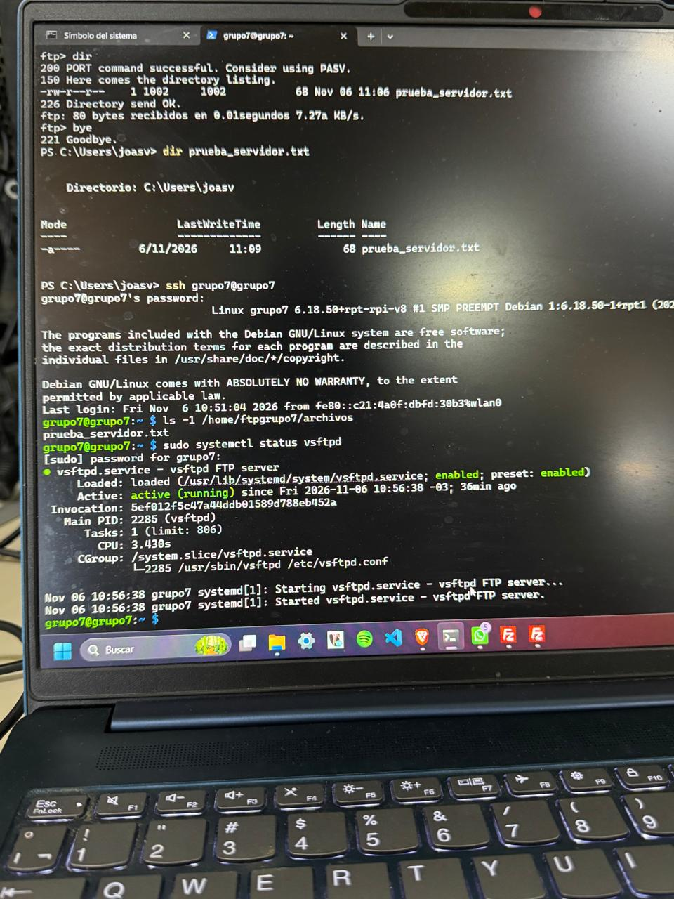
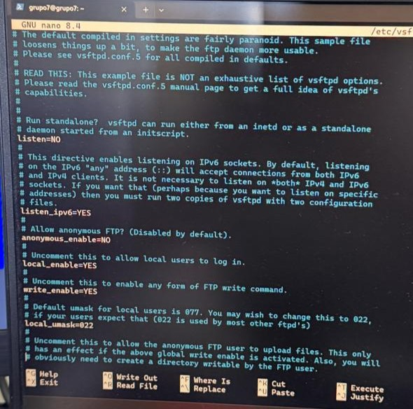
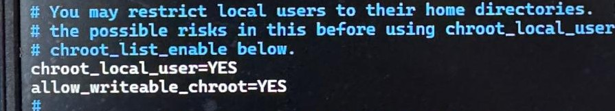
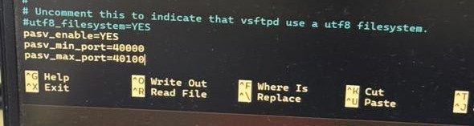
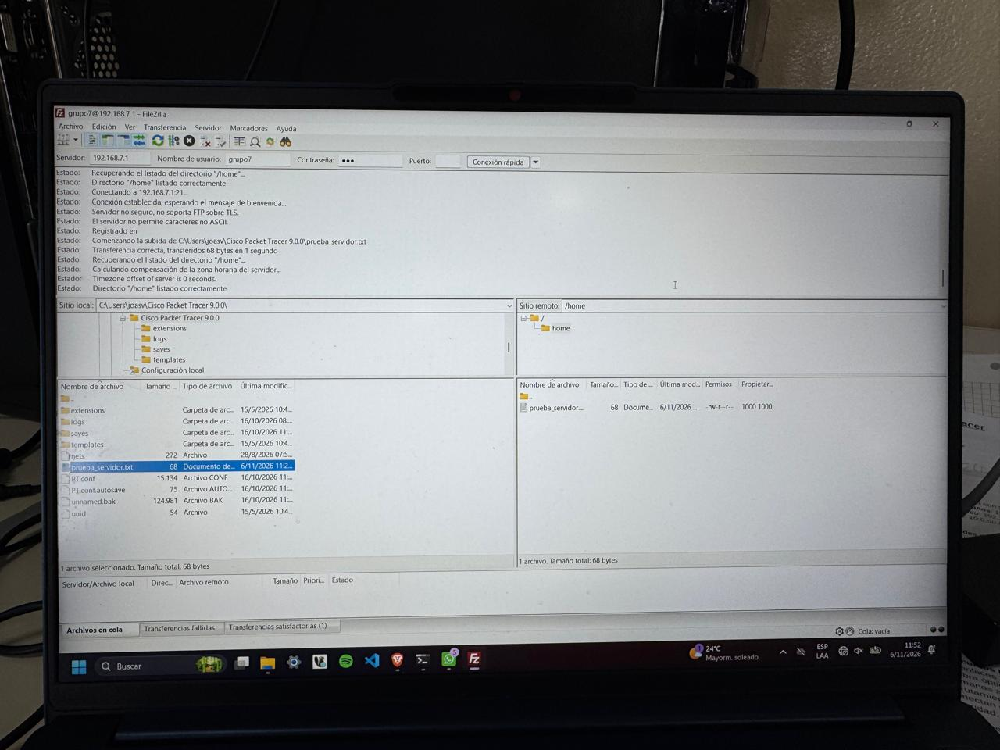
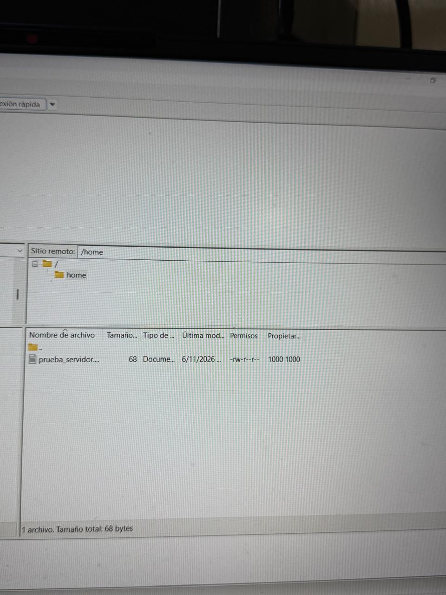
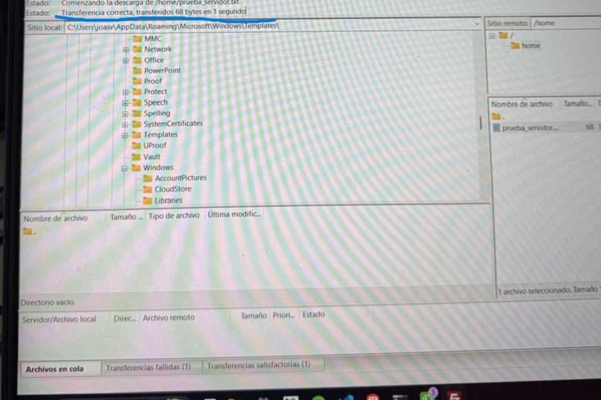

# CUARTA ENTREGA - SERVIDOR FTP MEDIANTE VSFTPD Y FILEZILLA

**Alumnos:** Candiotto Gino, Joaquin Sverko, Genaro Correa, Facundo Angelelli  
**Fecha:** 30 de octubre  
**Tema:** Instalación y configuración de un servidor FTP en Raspberry Pi y transferencia de archivos desde FileZilla

## 1. INTRODUCCIÓN

En las entregas anteriores se preparó la Raspberry Pi para funcionar como servidor dentro de una red local. Primero se instaló **Raspberry Pi OS Lite (64-bit)** y se habilitó **SSH** para acceder remotamente. Luego se trabajó con **Xorg y X11 Forwarding** para ejecutar aplicaciones gráficas de forma remota. En la tercera entrega se configuró un **servidor DHCP** para asignar automáticamente direcciones IP a los equipos conectados al switch del grupo.

En esta cuarta entrega incorporamos un nuevo servicio: **FTP (File Transfer Protocol)**. El objetivo es permitir que las computadoras de nuestra LAN puedan transferir archivos hacia la Raspberry Pi y descargarlos desde ella.

Para implementar el servidor se utilizó **vsftpd** y, para comprobar las transferencias de forma visual, se eligió **FileZilla Client** en una notebook con Windows. De esta manera, las operaciones de subir y descargar archivos pueden realizarse mediante una interfaz gráfica, sin necesidad de memorizar comandos de transferencia.

## 2. OBJETIVOS DE LA PRÁCTICA

- Comprender qué es FTP y para qué se utiliza.
- Diferenciar el servidor FTP del cliente FTP.
- Instalar y configurar `vsftpd` en la Raspberry Pi.
- Utilizar el usuario local `grupo7` para acceder al servidor FTP.
- Mantener la Raspberry conectada a la LAN del grupo mediante Ethernet.
- Utilizar **FileZilla** para conectarse al servidor y visualizar sus directorios.
- Probar la subida y la descarga de un archivo desde la interfaz gráfica.
- Identificar los aspectos básicos de seguridad de FTP.

## 3. ¿QUÉ ES FTP?

**FTP** significa *File Transfer Protocol*, o **Protocolo de Transferencia de Archivos**. Es un protocolo que permite intercambiar archivos entre dispositivos conectados a una red, tanto a través de Internet como dentro de una LAN.

En nuestro proyecto, la Raspberry Pi actúa como servidor: almacena los archivos y atiende las solicitudes de los equipos clientes. Desde la notebook utilizamos FileZilla para conectarnos, explorar carpetas, subir archivos o descargarlos.

FTP utiliza habitualmente el **puerto TCP 21** para la conexión de control. Las transferencias de datos se realizan mediante conexiones adicionales, que dependen del modo de funcionamiento, activo o pasivo.

> **Nota de seguridad:** FTP tradicional no cifra el usuario, la contraseña ni los archivos transferidos. Por eso se utiliza aquí únicamente para la práctica dentro de una LAN de laboratorio controlada y con una contraseña de prueba. Para redes no confiables conviene utilizar FTPS o SFTP, según corresponda.

## 4. CLIENTE Y SERVIDOR FTP

Los componentes principales de esta práctica son:

- **Servidor FTP:** la Raspberry Pi, que ejecuta el programa `vsftpd`.
- **Cliente FTP:** la notebook con Windows, que ejecuta **FileZilla Client**.
- **Red LAN:** el switch que conecta a la Raspberry y a las notebooks del grupo.

El funcionamiento general puede representarse así:

```text
          NOTEBOOK CON WINDOWS
             FileZilla Client
                    |
                    | FTP (puerto TCP 21)
                    |
                  SWITCH
                    |
                    v
              RASPBERRY PI
              192.168.7.1
                vsftpd
                    |
                    v
          Carpeta de archivos FTP
```

## 5. RED UTILIZADA

Se conservó la red definida en la tercera entrega, correspondiente al **grupo 7**:

```text
Red LAN:           192.168.7.0/24
Máscara:           255.255.255.0
IP de la Raspberry: 192.168.7.1
Interfaz LAN:      eth0
Puerto FTP:        TCP 21
```

La Raspberry Pi permanece conectada al switch mediante Ethernet, mientras que las notebooks clientes forman parte de la misma red. La dirección `192.168.7.1` identifica al servidor FTP y se utiliza para conectarse desde FileZilla.

La configuración DHCP realizada en la entrega anterior no necesita modificarse para agregar este nuevo servicio.

## 6. CONEXIÓN A INTERNET PARA INSTALAR EL SERVICIO

Para instalar `vsftpd` mediante los repositorios de Raspberry Pi OS, se necesita que la Raspberry tenga acceso a Internet. Como la interfaz Ethernet `eth0` se reserva para la LAN del grupo, se puede utilizar una conexión Wi-Fi independiente para descargar los paquetes.

La conexión inalámbrica se administra mediante **nmtui**, una interfaz de texto de NetworkManager que permite configurar la red utilizando menús:

```bash
sudo nmtui
```

Dentro de esta interfaz se selecciona **Activate a connection** (Activar una conexión), se elige la red Wi-Fi compartida por una computadora externa, se introduce su contraseña y se activa la conexión. Si no se muestran redes, conviene revisar que el adaptador inalámbrico esté habilitado antes de continuar.

La distribución de interfaces queda de la siguiente manera:

```text
wlan0 → Conexión Wi-Fi para acceder a Internet
eth0  → Red LAN 192.168.7.0/24 (IP de la Raspberry: 192.168.7.1)
```

De este modo se obtiene conectividad para descargar `vsftpd` sin modificar el servicio DHCP ni la IP fija de Ethernet.

## 7. INSTALACIÓN DEL SERVIDOR FTP

Para instalar el servidor se ingresó a la Raspberry mediante SSH desde la notebook:

```bash
ssh grupo7@192.168.7.1
```

Una vez dentro de la Raspberry, se actualizan los índices de paquetes:

```bash
sudo apt update
```

Luego se instala **vsftpd**:

```bash
sudo apt install vsftpd -y
```

El paquete `vsftpd` proporciona el servicio FTP. Para verificar su estado se utiliza:

```bash
sudo systemctl status vsftpd
```

Si funciona correctamente, debe aparecer un estado similar a:

```text
Active: active (running)
```

**Captura a incorporar:** estado real del servicio `vsftpd`.





## 8. CONFIGURACIÓN DEL SERVIDOR FTP

Antes de modificar la configuración, se realiza una copia de seguridad del archivo original:

```bash
sudo cp /etc/vsftpd.conf /etc/vsftpd.conf.backup
```

Luego se abre el archivo de configuración:

```bash
sudo nano /etc/vsftpd.conf
```

Para el FTP básico con usuarios locales se revisaron las siguientes directivas:

```ini
anonymous_enable=NO
local_enable=YES
write_enable=YES
local_umask=022
chroot_local_user=YES
allow_writeable_chroot=YES
pasv_enable=YES
pasv_min_port=40000
pasv_max_port=40100
```

Su función es la siguiente:

- **`anonymous_enable=NO`:** evita el acceso anónimo al servidor.
- **`local_enable=YES`:** permite iniciar sesión a usuarios locales autorizados.
- **`write_enable=YES`:** habilita operaciones de escritura, como subir archivos o crear carpetas, siempre que el usuario tenga permisos.
- **`local_umask=022`:** define permisos predeterminados de los archivos creados mediante FTP.
- **`chroot_local_user=YES`:** limita al usuario FTP a su directorio personal como raíz visible de la sesión.
- **`allow_writeable_chroot=YES`:** permite iniciar sesión aunque esa raíz sea escribible por `grupo7`. Esta opción reduce una protección de seguridad y se utiliza únicamente en esta LAN aislada de práctica.
- **`pasv_enable=YES`:** habilita el modo FTP pasivo.
- **`pasv_min_port` y `pasv_max_port`:** establecen un rango de puertos para conexiones de datos pasivas.

Tras guardar los cambios se reinicia el servicio:

```bash
sudo systemctl restart vsftpd
```

Para configurarlo de manera que se inicie automáticamente con el sistema:

```bash
sudo systemctl enable vsftpd
```

**Captura a incorporar:** opciones principales del archivo de configuración.






## 9. USUARIO Y DIRECTORIO PARA LA TRANSFERENCIA DE ARCHIVOS

Para el acceso FTP se utiliza **`grupo7`**, el usuario local que ya había sido creado durante la primera entrega para administrar la Raspberry Pi mediante SSH. No es necesario crear una cuenta distinta, porque `vsftpd` puede permitir la autenticación de usuarios locales del sistema con la directiva `local_enable=YES`.

Su directorio personal es:

```text
/home/grupo7
```

Como el usuario puede escribir en su directorio personal, en la configuración de `vsftpd` se establece:

```ini
chroot_local_user=YES
allow_writeable_chroot=YES
```

La primera opción restringe el acceso FTP al entorno del directorio personal; la segunda permite que la raíz de ese entorno sea escribible. Para este trabajo se usa dentro de una red local de laboratorio aislada, sin exponer el FTP a Internet.

Los archivos de prueba pueden guardarse directamente en `/home/grupo7`. Desde FileZilla se visualizan en el **sitio remoto**, donde pueden subirse, descargarse y organizarse con una interfaz gráfica.

## 10. ¿QUÉ ES FILEZILLA?

**FileZilla Client** es un programa que permite conectarse a servidores de archivos mediante una interfaz gráfica. En esta práctica se utiliza en Windows como cliente FTP para acceder al servicio que ejecuta la Raspberry Pi.

Su ventana muestra, entre otras secciones:

- **Sitio local:** archivos y carpetas de la notebook.
- **Sitio remoto:** archivos y carpetas del servidor FTP.
- **Registro de mensajes:** información sobre la conexión y las operaciones realizadas.
- **Cola de transferencias:** archivos pendientes, en proceso o transferidos.

Su principal ventaja para esta práctica es que permite transferir archivos seleccionándolos o arrastrándolos con el mouse, sin utilizar comandos FTP.

## 11. CONEXIÓN AL SERVIDOR DESDE FILEZILLA

En la notebook con Windows se abre **FileZilla Client** y se utiliza la barra superior de **Conexión rápida**, de manera que no sea necesario crear un perfil en el Gestor de sitios.

Los campos se completan con estos valores:

| Campo | Configuración |
|---|---|
| Servidor | `192.168.7.1` |
| Nombre de usuario | `grupo7` |
| Contraseña | La contraseña local de `grupo7` |
| Puerto | `21` |

Después se hace clic en **Conexión rápida**. El cliente establece la conexión con `vsftpd` en la Raspberry Pi.

Con el acceso autorizado, el **sitio remoto** (panel derecho) permite visualizar los archivos del directorio personal de `grupo7`.

**Captura a incorporar:** barra de Conexión rápida y vista de los archivos remotos, ocultando la contraseña.



## 12. PRUEBA DE SUBIDA DE ARCHIVOS MEDIANTE FILEZILLA

Para comprobar la transferencia desde la notebook hacia la Raspberry se propone utilizar un archivo de prueba, por ejemplo:

```text
prueba_servidor.txt
```

Desde la interfaz de FileZilla se sigue este procedimiento:

1. En el **panel izquierdo**, buscar el archivo `prueba.txt` en la notebook.
2. En el **panel derecho**, ubicar el directorio personal de `grupo7`.
3. Arrastrar `prueba.txt` desde el panel local hasta el panel remoto.
4. Comprobar que el archivo aparezca en el directorio remoto.
5. Revisar la sección de transferencias exitosas en la parte inferior de FileZilla.

Este procedimiento permite demostrar una operación de **subida**: el archivo sale de la notebook y se almacena en la Raspberry Pi.

**Captura a incorporar:** FileZilla mostrando el archivo en el sitio remoto





## 13. PRUEBA DE DESCARGA DE ARCHIVOS MEDIANTE FILEZILLA

Para comprobar la operación inversa se utiliza nuevamente la interfaz gráfica:

1. En el **panel derecho**, localizar `prueba.txt` en el directorio remoto de `grupo7`.
2. En el **panel izquierdo**, seleccionar una carpeta de destino en Windows.
3. Hacer clic derecho sobre el archivo remoto y seleccionar **Descargar**, o arrastrarlo desde el sitio remoto hacia el local.
4. Verificar que el archivo aparezca en la carpeta seleccionada de Windows.
5. Revisar la indicación de transferencia exitosa en FileZilla.

De esta manera se demuestra una **descarga**: el archivo se copia desde la Raspberry Pi hacia la notebook.

**Captura a incorporar:** FileZilla mostrando el archivo descargado en el sitio local y la transferencia finalizada.





## 14. COMPROBACIÓN VISUAL DEL FUNCIONAMIENTO

La comprobación del FTP se plantea directamente desde FileZilla, sin utilizar comandos de transferencia en CMD. Las capturas de las operaciones permiten dejar constancia de su resultado real.

Para considerar que la prueba fue exitosa, deben observarse estos resultados en la aplicación:

- FileZilla establece la conexión con el servidor `192.168.7.1`.
- El panel remoto muestra el directorio personal de `grupo7`.
- El archivo de prueba aparece en el servidor después de subirlo.
- El archivo vuelve a aparecer en la carpeta local de Windows después de descargarlo.
- La sección de transferencias de FileZilla no muestra errores para esas operaciones.

## 15. DIFERENCIA ENTRE LOS SERVICIOS INSTALADOS

Hasta esta entrega, la Raspberry Pi se utiliza para diferentes tareas dentro del proyecto:

| Servicio | Función |
|---|---|
| SSH | Permite administrar remotamente la Raspberry mediante una terminal segura. |
| X11 Forwarding | Permite mostrar en una computadora cliente la ventana de una aplicación ejecutada en la Raspberry. |
| DHCP | Entrega automáticamente direcciones IP a los dispositivos de la LAN. |
| FTP (`vsftpd`) | Permite subir y descargar archivos entre la notebook y la Raspberry. |


## 16. COMANDOS NECESARIOS PARA PREPARAR EL SERVIDOR

Aunque para las pruebas de transferencia se utiliza **FileZilla**, algunos pasos de instalación y administración del servidor en Raspberry Pi OS Lite requieren una terminal.

### 1. Acceder a la Raspberry mediante SSH

```bash
ssh grupo7@192.168.7.1
```

### 2. Abrir la interfaz interactiva de conexión de red

```bash
sudo nmtui
```

Permite administrar conexiones desde un menú, especialmente útil para activar una conexión Wi-Fi sin escribir comandos largos.

### 3. Actualizar la información de paquetes

```bash
sudo apt update
```

### 4. Instalar el servidor FTP

```bash
sudo apt install vsftpd -y
```

### 5. Consultar el estado del servidor

```bash
sudo systemctl status vsftpd
```

### 6. Editar el archivo de configuración

```bash
sudo nano /etc/vsftpd.conf
```

### 7. Reiniciar el servicio

```bash
sudo systemctl restart vsftpd
```

### 8. Habilitar el inicio automático

```bash
sudo systemctl enable vsftpd
```

## 17. RESULTADO FINAL

La configuración prevista para la cuarta entrega permite que la Raspberry Pi funcione como servidor FTP de la LAN del grupo 7.

El diseño final reúne las siguientes características:

- Raspberry Pi OS Lite (64-bit).
- Conexión Ethernet a la LAN `192.168.7.0/24`.
- Dirección fija de la Raspberry: `192.168.7.1`.
- Servicio FTP proporcionado por `vsftpd`.
- Usuario de transferencia: `grupo7`.
- Directorio remoto de archivos: `/home/grupo7`.
- Acceso desde Windows mediante FileZilla Client.
- Procedimiento de subida y descarga desde la interfaz gráfica, con espacios para incorporar las capturas reales de las pruebas.

**Esquema final:**

```text
                        RED 192.168.7.0/24

                       ┌─────────────┐
                       │   SWITCH    │
                       └──────┬──────┘
                              │
                ┌─────────────┴──────────────┐
                │                            │
                v                            v
      NOTEBOOK CON WINDOWS              RASPBERRY PI
        FileZilla Client                192.168.7.1
                │                       vsftpd / FTP
                │                            │
                └──── SUBIR / DESCARGAR ─────┘
```

## 18. CONCLUSIÓN

En esta cuarta entrega se incorporó a la Raspberry Pi un servicio para la transferencia de archivos dentro de la red local del grupo.

Se trabajó con **vsftpd** como servidor FTP y se eligió **FileZilla Client** como herramienta para conectarse desde Windows. Esta elección facilita las pruebas y la defensa del trabajo, porque permite visualizar las carpetas de ambos dispositivos y transferir archivos mediante el mouse.

La práctica permite comprender que el **servidor** es quien almacena y ofrece los archivos, mientras que el **cliente** inicia la conexión y solicita las operaciones de subida y descarga.

Con la incorporación de FTP, la Raspberry Pi continúa ampliando sus funciones como servidor de la LAN. Para completar la documentación, deben incorporarse las capturas reales de FileZilla que demuestren la conexión y las transferencias de archivos.
