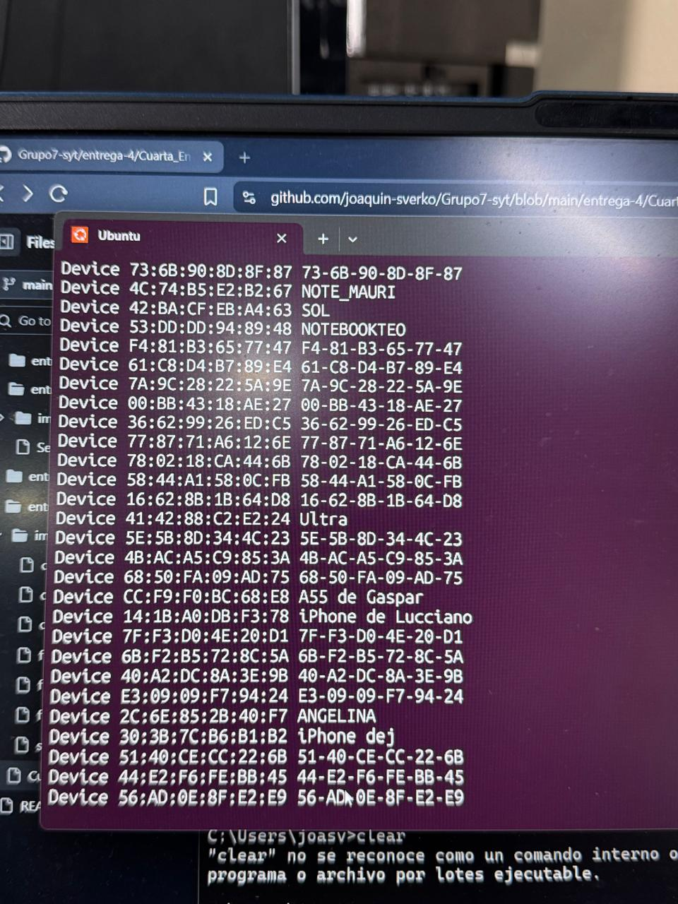
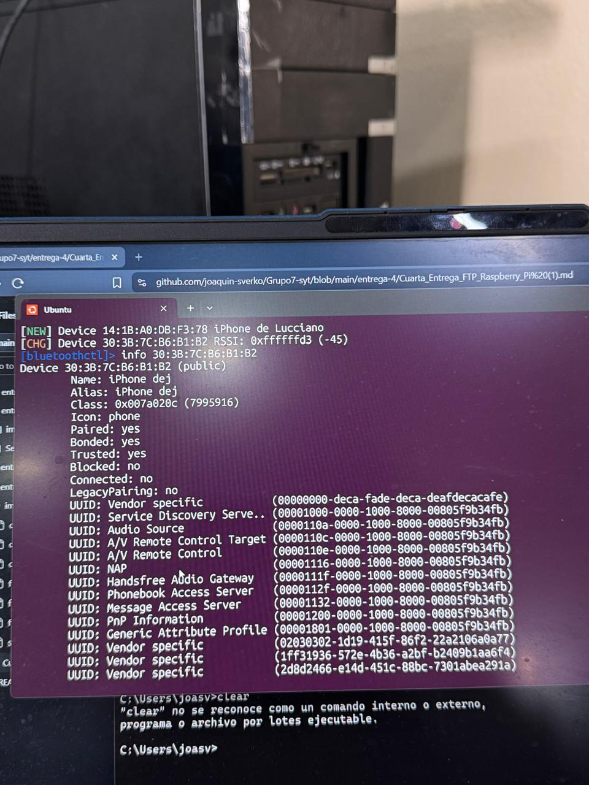
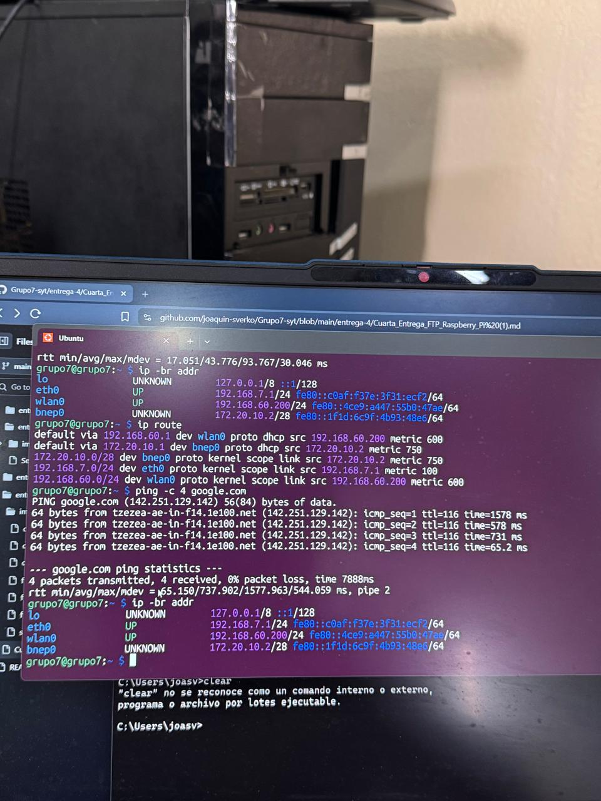
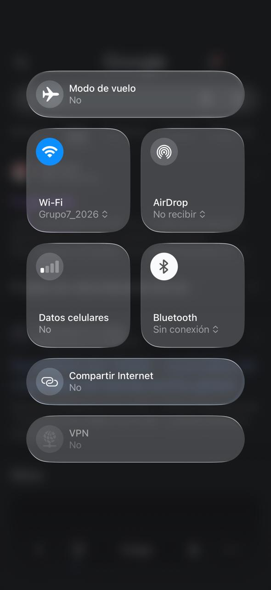
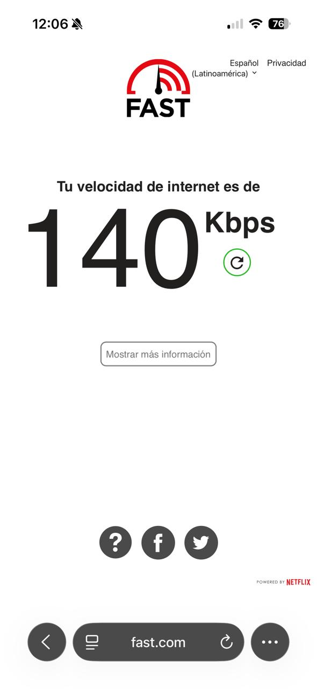

# QUINTA ENTREGA - INTERNET POR BLUETOOTH Y HOTSPOT WI-FI

**Alumnos:** Candiotto Gino, Joaquín Sverko, Genaro Correa, Facundo Angelelli  
**Fecha:** 13 de noviembre de 2026  
**Tema:** Compartir desde la Raspberry Pi 3, mediante un punto de acceso Wi-Fi, la conexión a Internet recibida de un iPhone por Bluetooth.

## 1. INTRODUCCIÓN

En las cuatro entregas anteriores preparamos una Raspberry Pi 3 con **Raspberry Pi OS Lite de 64 bits**, habilitamos el acceso remoto por **SSH**, trabajamos con **Xorg y X11 Forwarding**, configuramos un servidor **DHCP** para la red local y pusimos en funcionamiento un servicio **FTP**.

En esta quinta entrega agregamos una nueva función: utilizar la Raspberry como un **router inalámbrico básico**. Para ello, tomamos Internet de los datos móviles de un iPhone mediante Bluetooth y creamos una red Wi-Fi propia, llamada **`Grupo7_2026`**, a la que se pueden conectar otros dispositivos.

Mantuvimos los servicios de los TP anteriores. Para administrar las conexiones utilizamos principalmente **NetworkManager**, a través de su interfaz de texto **`nmtui`**. No instalamos `hostapd` ni configuramos un servidor DHCP nuevo para el hotspot: el modo de conexión compartida de NetworkManager se encargó de esa parte.

## 2. OBJETIVO Y ESQUEMA DE LA RED

El objetivo fue conseguir que la Raspberry reciba Internet por una interfaz y lo distribuya por otra:

- **Bluetooth (`bnep0`):** recibe Internet del iPhone.
- **Wi-Fi (`wlan0`):** crea el punto de acceso `Grupo7_2026`.
- **Ethernet (`eth0`):** conserva la red local de las entregas anteriores, configurada con `192.168.7.1/24`.

```text
       iPhone con datos móviles
                 |
          Bluetooth PAN
                 |
          Raspberry Pi 3
          bnep0: entrada
          wlan0: hotspot
                 |
           Grupo7_2026
                 |
         Otro celular / PC
            con Internet
```

La conexión Bluetooth PAN (*Personal Area Network*) permite utilizar el teléfono como proveedor de Internet. Por otro lado, un **punto de acceso** (*Access Point* o AP) permite que la Raspberry emita una red Wi-Fi para que otros equipos se conecten.

El trabajo no consiste en conectarse al Wi-Fi del iPhone: la Raspberry obtiene Internet **por Bluetooth**, y luego lo comparte **por Wi-Fi**.

## 3. PREPARACIÓN DEL IPHONE

Antes de configurar la Raspberry, preparamos el iPhone que usaríamos como fuente de Internet:

1. Activamos los **datos móviles**.
2. Encendimos **Bluetooth**.
3. Entramos en **Configuración > Compartir Internet**.
4. Habilitamos **Permitir a otros conectarse**.
5. Mantuvimos el teléfono disponible para realizar el emparejamiento.

Para la prueba final utilizamos **otro celular** distinto del que compartía los datos móviles.

## 4. EMPAREJAMIENTO DEL IPHONE MEDIANTE BLUETOOTH

En la terminal de la Raspberry abrimos la herramienta de administración Bluetooth:

```bash
bluetoothctl
```

Dentro de la consola interactiva ejecutamos los siguientes comandos, uno por uno:

```text
power on
agent on
default-agent
scan bredr
```

- **`power on`:** enciende el adaptador Bluetooth de la Raspberry.
- **`agent on`:** activa el agente que gestiona las solicitudes de emparejamiento y la confirmación de códigos.
- **`default-agent`:** establece ese agente como el predeterminado.
- **`scan bredr`:** busca dispositivos que utilizan Bluetooth clásico, como el iPhone que queríamos vincular.

Al comenzar la búsqueda, identificamos el iPhone entre los dispositivos detectados y anotamos su **dirección Bluetooth**. En los ejemplos siguientes utilizamos `AA:BB:CC:DD:EE:FF`, que debe reemplazarse por la dirección real del teléfono.



Detuvimos la búsqueda e iniciamos el emparejamiento:

```text
scan off
pair AA:BB:CC:DD:EE:FF
```

Aceptamos la solicitud en el iPhone y, cuando correspondió, confirmamos el código de vinculación. Después marcamos el teléfono como confiable y salimos:

```text
trust AA:BB:CC:DD:EE:FF
exit
```



Con este paso logramos **vincular el iPhone a la Raspberry**. Sin embargo, el emparejamiento por sí solo no proporciona Internet: todavía había que activar la conexión de red del teléfono.

## 5. CONEXIÓN A INTERNET POR BLUETOOTH

Para activar la conexión de red utilizamos la interfaz de texto de NetworkManager:

```bash
sudo nmtui
```

Dentro de `nmtui` entramos en **Activate a connection**, seleccionamos el perfil correspondiente al iPhone y lo activamos. En nuestra Raspberry figuraba con el nombre **`iPhone dej Network`**. Es una conexión **Bluetooth PAN**, que al activarse crea la interfaz de red `bnep0`.

Desde la misma pantalla desactivamos la conexión Wi-Fi del colegio (**`PROGRAMACION-FAT`**) para dejar libre `wlan0` y evitar que el sistema saliera a Internet por esa red. **No borramos su perfil**.

Una vez activado Bluetooth, comprobamos qué interfaz estaba utilizando la Raspberry para salir a Internet:

```bash
ip route get 8.8.8.8
```

En nuestra práctica obtuvimos una ruta como esta:

```text
8.8.8.8 via 172.20.10.1 dev bnep0 src 172.20.10.2
```

Esto indica que el tráfico hacia Internet se envía por **`bnep0`**, utilizando como puerta de enlace al iPhone (`172.20.10.1`). La dirección `172.20.10.2` fue asignada a la Raspberry en esa conexión. Estos valores pueden cambiar de un teléfono a otro.



Comprobamos que realmente había Internet ejecutando:

```bash
ping -c 4 8.8.8.8
```

Recibimos respuestas a los cuatro paquetes. De esta manera confirmamos que la Raspberry tenía Internet **antes** de configurar el hotspot.

## 6. CREACIÓN DEL HOTSPOT WI-FI

El siguiente objetivo fue convertir la interfaz Wi-Fi de la Raspberry en un punto de acceso para otros equipos.

Primero comprobamos que el adaptador inalámbrico admitiera el modo AP:

```bash
iw list
```

Dentro del resultado encontramos:

```text
Supported interface modes:
    * managed
    * AP
```

El modo **`managed`** sirve para conectarse a una red Wi-Fi existente; **`AP`** permite crear una red propia. Así confirmamos que la Raspberry Pi 3 podía realizar esta función.

Volvimos a abrir la interfaz de NetworkManager:

```bash
sudo nmtui
```

Ingresamos en **Edit a connection > Add > Wi-Fi** y creamos el perfil con estos datos:

| Campo | Valor utilizado |
|---|---|
| Nombre del perfil | `Hotspot Grupo7` |
| Dispositivo | `wlan0` |
| Nombre de la red (SSID) | `Grupo7_2026` |
| Modo | `Access Point` |
| Banda | 2,4 GHz |
| Seguridad | WPA2 Personal (`WPA-PSK`) |
| Contraseña | `contraseña` |
| Configuración IPv4 | `Shared` |

Guardamos la conexión. Es importante diferenciar **`Hotspot Grupo7`**, que es el nombre interno del perfil en NetworkManager, de **`Grupo7_2026`**, que es el nombre visible de la red Wi-Fi.

En nuestra Raspberry Pi 3 también tuvimos que aplicar este ajuste de compatibilidad antes de poder utilizar el hotspot:

```bash
sudo nmcli connection modify "Hotspot Grupo7" 802-11-wireless-security.pmf 1
```

La propiedad **PMF** (*Protected Management Frames*) agrega protección a determinadas tramas de administración Wi-Fi. El valor `1` la desactiva para esta conexión, manteniendo la contraseña WPA2. Utilizamos este ajuste para que el punto de acceso se iniciara correctamente en nuestro equipo de práctica.

Luego activamos el perfil:

```bash
sudo nmcli connection up "Hotspot Grupo7"
```

NetworkManager confirmó que la conexión se había activado. A partir de ese momento, otros dispositivos pudieron encontrar la red **`Grupo7_2026`**.

## 7. CÓMO SE COMPARTE INTERNET: DHCP, DNS, NAT Y ENRUTAMIENTO

Crear una red Wi-Fi no alcanza para proporcionar Internet. Los clientes también necesitan una dirección IP, una puerta de enlace y la posibilidad de enviar su tráfico hacia la conexión Bluetooth.

La opción **`Shared`**, que seleccionamos en el perfil del hotspot, permitió que NetworkManager administrara automáticamente varias funciones:

- **DHCP:** asigna parámetros de red a los dispositivos conectados por Wi-Fi.
- **DNS:** ofrece a los clientes la posibilidad de resolver nombres de dominio como `google.com`.
- **NAT (enmascaramiento):** traduce las direcciones de origen de los dispositivos del hotspot para que compartan la conexión de salida.
- **Reenvío de paquetes:** permite que el tráfico pase entre las interfaces de la Raspberry.

En nuestro caso, la red Wi-Fi creada por NetworkManager fue **`10.42.0.0/24`**, distinta de la red Ethernet **`192.168.7.0/24`** que ya habíamos configurado en el TP3. Por lo tanto, **no ampliamos `isc-dhcp-server` a `wlan0`** ni modificamos el DHCP anterior.

### Reenvío IPv4

Para habilitar el reenvío de paquetes IPv4 ejecutamos:

```bash
sudo sysctl -w net.ipv4.ip_forward=1
```

El valor `1` significa que Linux puede reenviar paquetes entre distintas interfaces de red. Para que esta opción también se aplicara después de reiniciar, dejamos el archivo **`/etc/sysctl.d/99-router.conf`** con el siguiente contenido:

```text
net.ipv4.ip_forward=1
```

### Comprobación de la conexión compartida y NAT

Comprobamos el modo IPv4 del perfil:

```bash
nmcli -f ipv4.method connection show "Hotspot Grupo7"
```

El resultado fue:

```text
ipv4.method: shared
```

También consultamos las reglas de red:

```bash
sudo nft list ruleset
```

Encontramos una tabla creada por NetworkManager llamada **`nm-shared-wlan0`**, con esta regla de enmascaramiento:

```text
ip saddr 10.42.0.0/24 ip daddr != 10.42.0.0/24 masquerade
```

Esto muestra que NetworkManager configuró el NAT para la red Wi-Fi. 

## 8. CONFIGURACIÓN PARA QUE SE ACTIVE AL ENCENDER LA RASPBERRY

Una vez que pudimos conectarnos al hotspot y navegar, dejamos configurado el inicio automático de los perfiles utilizados.

Para el punto de acceso ejecutamos:

```bash
sudo nmcli connection modify "Hotspot Grupo7" connection.autoconnect yes connection.autoconnect-priority 100
```

Con `autoconnect yes`, NetworkManager intenta activar el hotspot al iniciar. La prioridad indicada favorece este perfil frente a otras redes Wi-Fi guardadas.

Para la conexión del iPhone utilizamos:

```bash
sudo nmcli connection modify "iPhone dej Network" connection.autoconnect yes
```

De esta manera, NetworkManager puede intentar recuperar la conexión Bluetooth cuando el iPhone está disponible. Para ello, el teléfono debe mantener Bluetooth y **Compartir Internet** habilitados.

El modo `Shared` también permite que NetworkManager vuelva a generar las reglas necesarias para compartir Internet al activar el hotspot.

## 9. COMPROBACIONES FINALES

Con Bluetooth y el hotspot funcionando al mismo tiempo, revisamos el estado de las conexiones:

```bash
nmcli device status
```

En nuestra Raspberry observamos:

| Conexión | Interfaz o dispositivo | Estado |
|---|---|---|
| `Hotspot Grupo7` | `wlan0` | `connected` |
| `iPhone dej Network` | Bluetooth | `connected` |
| `Wired connection 1` | `eth0` | `connected` |


Para comprobar que el punto de acceso también distribuía Internet, tomamos **otro celular**, buscamos la red **`Grupo7_2026`**, ingresamos la contraseña **`contraseña`** y abrimos páginas de Internet. La navegación funcionó correctamente.





Finalmente reiniciamos la Raspberry:

```bash
sudo reboot
```

Después del reinicio comprobamos que las conexiones volvieran a estar disponibles y que el celular pudiera navegar nuevamente por **`Grupo7_2026`**. Así verificamos que la configuración utilizada para el TP se mantenía.

## 10. CONCLUSIÓN

En esta entrega logramos que la Raspberry Pi 3 **recibiera Internet mediante Bluetooth desde un iPhone y lo compartiera mediante una red Wi-Fi propia**. La conexión de entrada se realizó por `bnep0`, mientras que `wlan0` funcionó como punto de acceso con el nombre `Grupo7_2026`.

La principal diferencia respecto de los trabajos anteriores fue que la Raspberry dejó de utilizarse únicamente como servidor dentro de la red local y pasó a **conectar dos redes y distribuir Internet**. Para lograrlo combinamos Bluetooth PAN, la configuración del hotspot, el reenvío de paquetes y la traducción de direcciones NAT.

La utilización de **NetworkManager y `nmtui`** simplificó la configuración: el modo **`Shared`** se encargó de las funciones de DHCP, DNS y NAT de la red inalámbrica sin necesidad de instalar y configurar otros servicios para el hotspot. También mantuvimos los servicios de SSH, DHCP por Ethernet y FTP de las entregas anteriores.

Como prueba final, otro celular logró conectarse a **`Grupo7_2026`** y navegar usando los datos móviles del iPhone original. El funcionamiento se verificó nuevamente después de reiniciar la Raspberry.
