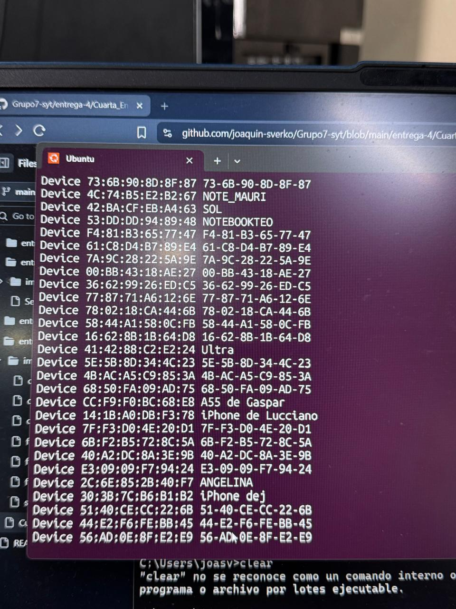
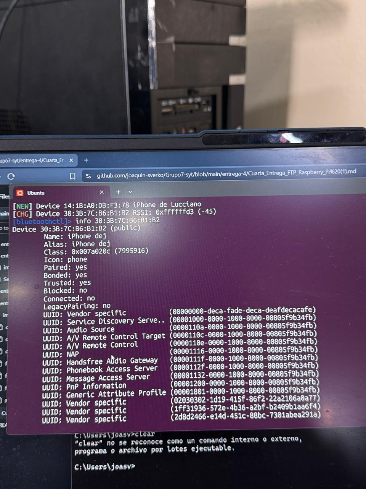
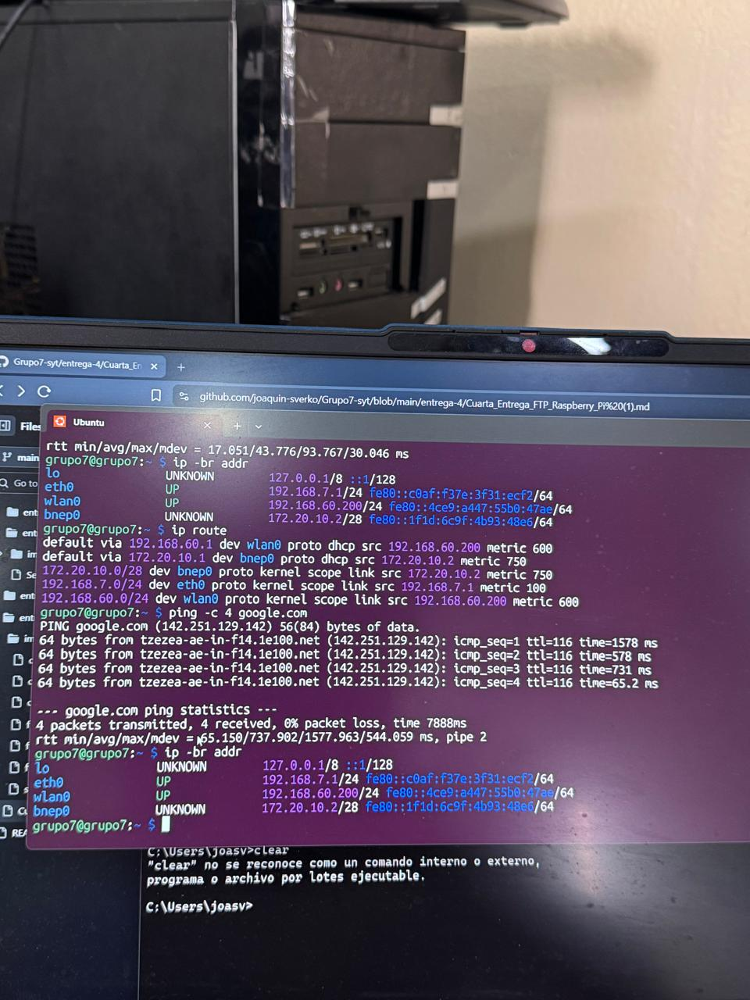
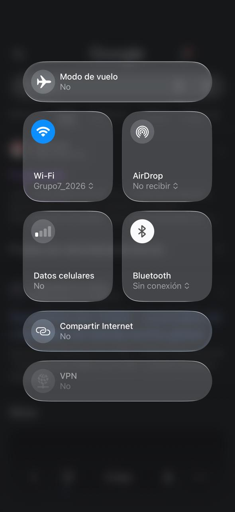
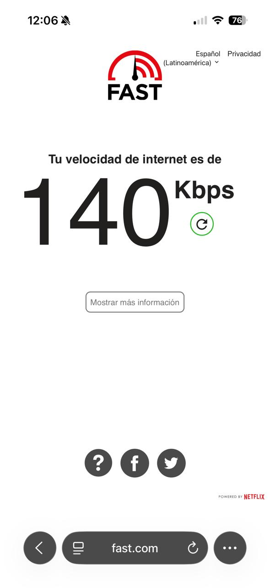

# QUINTA ENTREGA - INTERNET POR BLUETOOTH Y HOTSPOT WI-FI

**Alumnos:** Candiotto Gino, Joaquín Sverko, Genaro Correa, Facundo Angelelli  
**Fecha:** 13 de noviembre de 2026  
**Tema:** Recibir Internet desde un iPhone mediante Bluetooth y compartirlo por Wi-Fi desde una Raspberry Pi 3.

## 1. INTRODUCCIÓN

En las primeras cuatro entregas instalamos Raspberry Pi OS Lite (64 bits) y configuramos SSH, la red local y el servidor DHCP, Xorg con X11 Forwarding y FTP. En esta quinta entrega usamos la misma Raspberry Pi 3 para recibir Internet desde los datos móviles de un iPhone mediante **Bluetooth** y crear un punto de acceso Wi-Fi llamado **`Grupo7_2026`**. Otro dispositivo se conecta a esa red y navega utilizando Internet del iPhone.

No instalamos un entorno de escritorio ni un servidor de hotspot por separado: usamos **NetworkManager**, que ya teníamos en la Raspberry.

## 2. OBJETIVO Y FUNCIONAMIENTO

- Conectar la Raspberry al iPhone mediante Bluetooth PAN.
- Verificar que la Raspberry recibe Internet por la interfaz `bnep0`.
- Convertir `wlan0` en un hotspot protegido con contraseña.
- Compartir Internet con los clientes del hotspot mediante el modo `shared` de NetworkManager.
- Conservar la configuración tras reiniciar.

```text
 iPhone (datos móviles)
         |
   Bluetooth PAN
         |
   Raspberry Pi 3
   bnep0: Internet recibido
   wlan0: Hotspot Grupo7_2026
         |
      Wi-Fi
         |
  Otro celular o notebook
```

## 3. PREPARACIÓN DEL IPHONE

1. Activamos **Datos móviles** y **Bluetooth** en el iPhone.
2. Entramos a **Configuración > Compartir Internet**.
3. Activamos **Permitir a otros conectarse**.
4. Dejamos el iPhone disponible para emparejarlo con la Raspberry.

**Importante:** el iPhone proporciona Internet **por Bluetooth**, no por Wi-Fi. Para la prueba final usamos otro celular como cliente del hotspot.

## 4. EMPAREJAR EL IPHONE CON LA RASPBERRY

Abrimos la consola Bluetooth de la Raspberry:

```bash
bluetoothctl
```

Dentro de `bluetoothctl` ejecutamos, uno por uno:

```text
power on
agent on
default-agent
scan bredr
```

La Raspberry comienza a buscar dispositivos Bluetooth. Identificamos el iPhone por su nombre y anotamos la dirección que muestra, por ejemplo `AA:BB:CC:DD:EE:FF` (**la dirección de cada iPhone será diferente**).


Detenemos la búsqueda y emparejamos el teléfono:

```text
scan off
pair AA:BB:CC:DD:EE:FF
```

Aceptamos la solicitud de vinculación en el iPhone y confirmamos el código de emparejamiento si aparece. Después marcamos el dispositivo como confiable:

```text
trust AA:BB:CC:DD:EE:FF
exit
```

Con esto queda vinculado el iPhone, pero **todavía falta activar su conexión de Internet**.

Su función es la siguiente:

- **`power on`:** enciende el adaptador Bluetooth de la Raspberry Pi para poder utilizarlo.

- **`agent on`:** activa el agente de Bluetooth, encargado de gestionar las solicitudes de emparejamiento, como la confirmación de códigos o autorizaciones.

- **`default-agent`:** establece el agente activado como predeterminado, para que gestione los emparejamientos con otros dispositivos.

- **`scan bredr`:** inicia la búsqueda de dispositivos que utilizan Bluetooth clásico (BR/EDR), como el iPhone con el que queremos compartir Internet.


## 5. CONECTAR INTERNET POR BLUETOOTH CON NETWORKMANAGER

En la terminal ejecutamos:

```bash
sudo nmtui
```

Entramos en **Activate a connection**, buscamos la conexión de red del iPhone y la activamos. En nuestra Raspberry figuraba como **`iPhone dej Network`**. Esta conexión es de tipo Bluetooth PAN y crea la interfaz `bnep0`.

Salimos de `nmtui` y comprobamos la ruta:

```bash
ip route get 8.8.8.8
```

En nuestro caso el resultado incluyó:

```text
8.8.8.8 via 172.20.10.1 dev bnep0 src 172.20.10.2
```

`bnep0` indica que la salida a Internet es Bluetooth. Las direcciones `172.20.10.1` y `172.20.10.2` fueron las que recibimos nosotros; pueden cambiar.

Aqui una muestra de las interfaces activas:



Verificamos la conexión:

```bash
ping -c 4 8.8.8.8
```

Recibimos respuestas, por lo que la Raspberry ya tenía Internet desde el iPhone. También **desactivamos la conexión Wi-Fi del colegio** desde `nmtui`, para que la salida principal fuera por Bluetooth y `wlan0` quedara disponible para el hotspot. No borramos el perfil del colegio.


## 6. CREAR EL HOTSPOT GRUPO7_2026

Volvimos a abrir:

```bash
sudo nmtui
```

Entramos en **Edit a connection > Add > Wi-Fi** y creamos la conexión con los siguientes valores:

| Opción | Configuración |
|---|---|
| Profile name | `Hotspot Grupo7` |
| Device | `wlan0` |
| SSID | `Grupo7_2026` |
| Mode | `Access Point` |
| Banda | 2,4 GHz |
| Seguridad | WPA2 Personal (WPA-PSK) |
| Contraseña | `contraseña` |
| IPv4 Configuration | `Shared` |

Guardamos el perfil y salimos. **`Hotspot Grupo7`** es el nombre de la conexión guardada en la Raspberry; **`Grupo7_2026`** es el nombre de la red que ven los celulares.

Para que el hotspot iniciara correctamente en nuestra Raspberry Pi 3, aplicamos este ajuste de compatibilidad:

```bash
sudo nmcli connection modify "Hotspot Grupo7" 802-11-wireless-security.pmf 1
```

Este comando desactiva PMF (*Protected Management Frames*) para el punto de acceso. Mantiene la contraseña WPA2, pero reduce una protección adicional; fue el ajuste que necesitamos en nuestra red de práctica.

Activamos el hotspot:

```bash
sudo nmcli connection up "Hotspot Grupo7"
```

NetworkManager confirmó que la conexión se había activado.

## 8. COMPARTIR INTERNET: IP FORWARDING, DHCP, DNS Y NAT

La configuración **IPv4: Shared** de `Hotspot Grupo7` permite que NetworkManager entregue direcciones IP y parámetros DNS a los equipos Wi-Fi y cree las reglas de NAT necesarias para compartir la conexión de Internet.

Nuestra red del hotspot quedó en `10.42.0.0/24`. Esto es independiente del DHCP que ya teníamos configurado en `eth0` para la red `192.168.7.0/24`.

También habilitamos el reenvío IPv4 en la Raspberry:

```bash
sudo sysctl -w net.ipv4.ip_forward=1
```

Para mantener ese ajuste tras el reinicio, dejamos el archivo **`/etc/sysctl.d/99-router.conf`** con esta línea:

```text
net.ipv4.ip_forward=1
```

Para revisar que NetworkManager estuviera usando el modo compartido:

```bash
nmcli -f ipv4.method connection show "Hotspot Grupo7"
```

El resultado fue:

```text
ipv4.method: shared
```

También comprobamos las reglas NAT:

```bash
sudo nft list ruleset
```

Apareció la tabla `nm-shared-wlan0`, con una regla `masquerade` para `10.42.0.0/24`. **No agregamos reglas NAT manuales para el hotspot**: NetworkManager las creó automáticamente.

## 9. ACTIVAR AUTOMÁTICAMENTE LAS CONEXIONES

Para que el punto de acceso se active al arrancar la Raspberry ejecutamos:

```bash
sudo nmcli connection modify "Hotspot Grupo7" connection.autoconnect yes connection.autoconnect-priority 100
```

Para permitir que la conexión Bluetooth guardada se reconecte automáticamente:

```bash
sudo nmcli connection modify "iPhone dej Network" connection.autoconnect yes
```

El iPhone tiene que estar disponible, con Bluetooth y **Compartir Internet** activados, para poder reconectarse.

## 10. PRUEBAS FINALES

Primero verificamos el estado de las conexiones:

```bash
nmcli device status
```

Observamos `wlan0` conectada a **`Hotspot Grupo7`**, la conexión Bluetooth a **`iPhone dej Network`** y `eth0` con su conexión de las entregas anteriores.

Probamos que la Raspberry siguiera teniendo Internet mientras emitía el hotspot:

```bash
ping -c 4 8.8.8.8
```

La prueba respondió correctamente.

Después, desde **otro celular**, buscamos la red **`Grupo7_2026`**, ingresamos la contraseña **`contraseña`** y comprobamos que podíamos navegar por Internet. Así verificamos que la conexión llegaba desde el iPhone por Bluetooth y salía hacia el cliente por Wi-Fi.

Finalmente, reiniciamos la Raspberry:

```bash
sudo reboot
```

Después de iniciar nuevamente, el hotspot y la conexión Bluetooth quedaron operativos y volvimos a navegar desde el celular conectado a `Grupo7_2026`.



## 11. CONCLUSIÓN

Completamos la quinta entrega haciendo que la Raspberry Pi 3 funcionara como un router Wi-Fi básico. Recibió Internet de un iPhone mediante Bluetooth PAN (`bnep0`) y lo compartió por el punto de acceso `Grupo7_2026` (`wlan0`). Usamos NetworkManager para configurar el hotspot y administrar DHCP, DNS y NAT, sin instalar un escritorio completo ni modificar los servicios de las entregas anteriores.

**Alcance de esta guía:** describe el camino que efectivamente utilizamos. Parte de una Raspberry con la configuración de los TP anteriores y con el perfil Bluetooth PAN visible en `nmtui` después de emparejar el iPhone. Si en otra instalación ese perfil no aparece, ese caso no se presentó en nuestra práctica y requeriría una configuración adicional; no incluimos comandos que nosotros no usamos.
